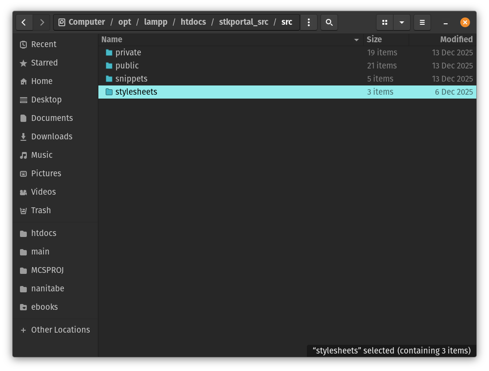

### How to Set Up the Source Code
1. Download the source code by clicking "Code" and selecting "Download ZIP."
2. Create a new folder named `stkportal_src` inside the `htdocs` directory.
3. Open the `stkportal_src` folder and create a subfolder named `src` inside it.
4. Extract the contents of the `STKPortal-main.zip` file.
5. Navigate to the `STKPortal-main` folder.
6. Select all the files in this folder.
7. Drag and drop these files into the `src` folder you created earlier.

`src` folder should look like this

---

### Setting Up the Database
1. Create a new database called `test_tree_db`.
2. Import the `test_tree_db.sql` file into the newly created database.

---

###### Open yung website
paste sa browser:
`http://localhost/stkportal_src/src/public/homepage.php`
